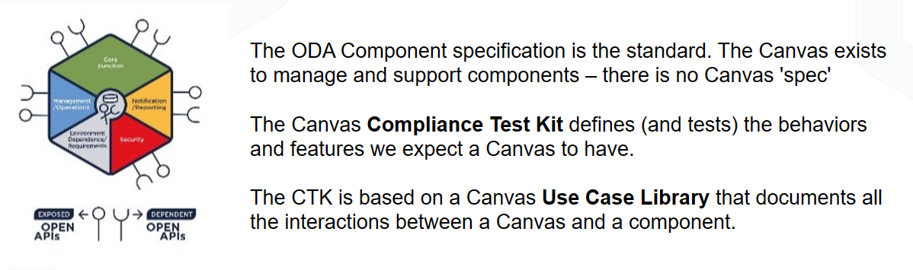
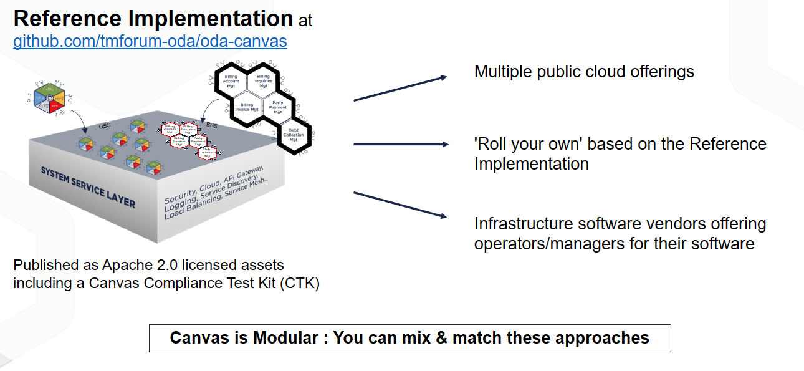
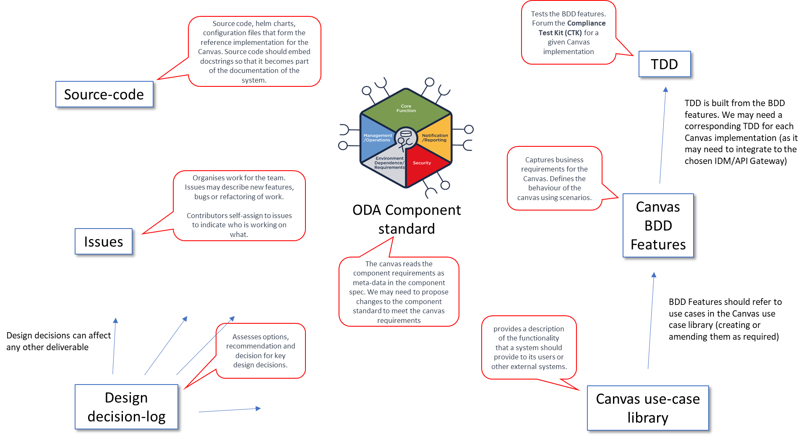

# ODA Canvas Design

## What is the ODA Canvas?

The ODA Canvas is the cloud-native execution environment for ODA Components, and the release automation part of a CI/CD pipeline. An ODA Component declares its non-functional needs alongside its business function: the APIs it exposes and depends on, the events it publishes and subscribes to, its security roles and its observability. The Canvas reads those declarations and provides the shared services that meet them. For example, it configures an API gateway or service mesh so that the component can expose its APIs in a standard way, an identity platform so that the component's roles can be granted to users, a secrets vault, and observability services so that the component can be monitored and managed.

This is what makes IT composable. Use cases are assembled from standard components, the components are deployed onto a Canvas, and Canvas operators configure the underlying platform services, which can be open-source reference modules or commercial cloud services. The same model extends to AI: in the [AI-Native Canvas](AI-Native-Canvas-design.md), AI agents are packaged as agentic components, components expose their APIs as tools for agents with the Model Context Protocol, and the Canvas adds AI and data services such as an AI gateway.

For a comprehensive introduction to ODA and the role of the Canvas in implementation and deployment, see [ODA explained: tools for implementation and deployment](https://inform.tmforum.org/features-and-opinion/oda-explained-tools-for-implementation-and-deployment) and the [ODA Canvas training videos](https://tmforum-oda.github.io/oda-ca-docs/docs/training-videos/index.html). To explore available ODA Components that can be deployed on the Canvas, visit the [ODA Component Directory](https://www.tmforum.org/oda/directory).

There is not an explicit standard or specification for the Canvas: the standard is the ODA Component Specification, which reached `v1`, its generally available version, in December 2024. The Canvas is a platform that can consume ODA Components, read metadata from the component spec and then execute whatever lifecycle process is required to meet those requirements.

We expect that there will be multiple implementations of the Canvas. This repository contains a Reference Implementation that teams can use to accelerate their own implementation. The Reference Implementation is generally available, is designed to be deployed on Kubernetes, and has been tested on AWS EKS, Azure AKS, Google GKE, Rancher, MicroK8s, Minikube, Docker Desktop, Kind and K3s (see the [Installation Guide](installation/README.md)). We expect all Canvas implementations to exhibit a standard set of behaviours. These are documented at a high level in the [use case library](usecase-library/README.md), and at a more detailed level as BDD (Behaviour-Driven Development) features and scenarios. The [test kit](feature-definition-and-test-kit/README.md) turns these into executable tests that can be used to validate any Canvas implementation, and they run against the Reference Implementation on every change.

## How do I buy or build a Canvas?

With a traditional application, you buy the software and its platform together: every vendor brings its own API gateway, identity management and monitoring. The ODA Canvas separates the two. Components declare what they need, and the Canvas provides it using the platform services you choose. So a Canvas is not one product. It is a modular platform, built from [Canvas operators](source/operators/README.md).

There are three ways to get a Canvas:

* **Public cloud offerings.** Public cloud providers offer a managed Canvas on top of their managed Kubernetes services. At DTW Copenhagen there were proof-of-concept demonstrations from AWS, Azure, China Mobile, Google Cloud and Oracle Cloud. These offerings are typically based on the Reference Implementation, and integrate with the provider's own services for API management, observability and so on.
* **Roll your own, from the Reference Implementation.** The Reference Implementation is released under the Apache 2.0 licence and is designed to be extended. You can install it as it is (see the [Installation Guide](installation/README.md)), or add your own operators for your own requirements.
* **Operators from software vendors and open-source projects.** Many infrastructure products already use the Kubernetes operator pattern, and a vendor can provide a Canvas operator for its own product. For example, the API Management operators for Azure API Management, Google Apigee and Whale Cloud configure those products from the same `ExposedAPI` resource that the Istio, Kong and Apache APISIX operators use.

### Mix and match

These are not either-or choices. Because the Canvas is modular, you can combine all three: for example, a cloud provider's API management, the reference Identity Config operator, and your own operator for an in-house system. We expect a typical production Canvas to combine standard operators with custom operators that apply the organization's own operational policies.

Choosing the modules is configuration, not code. In the Reference Implementation, the [canvas-oda Helm chart values](https://github.com/tmforum-oda/oda-canvas/blob/main/charts/canvas-oda/values.yaml) select which operators are installed. Only one API operator (Istio, Kong or Apache APISIX) can be enabled at a time, and the [Dependency Management](source/operators/TMFOP005-Dependency-Management/README.md) operator has two implementations: a simple one, and one that waits for access to be granted in Keycloak. Changing an operator does not change the components.

### How you know it is a Canvas

Whichever route you take, there is an objective way to check the result. The behaviour that every Canvas must show is written down in two places: the [use case library](usecase-library/README.md) describes it at a high level, and the BDD (Behaviour-Driven Development) features in the [test kit](feature-definition-and-test-kit/README.md) describe it in detail, as scenarios. The test kit turns the scenarios into executable tests that can validate any Canvas implementation. The Reference Implementation runs them on every change, and the Canvas Portal has a BDD page that loads the features from this repository and runs them against your own Canvas.

### Build your own operator

Operators can be written in any language that follows the [Kubernetes operator pattern](https://kubernetes.io/docs/concepts/extend-kubernetes/operator/). The reference operators use Python with the [KOPF](https://kopf.readthedocs.io/) framework, and Go. To work with the rest of the Canvas, an operator uses the same standard custom resources (`Component`, `ExposedAPI`, `DependentAPI`, `IdentityConfig`, `SecretsManagement` and the others). The [create-oda-operator](skills/create-oda-operator/SKILL.md) skill helps an AI coding assistant to create a new operator, and the test kit's features can be used to test it.

## Canvas Design structure

This is an outline of how the Canvas design is documented, and a pointer to the different design artefacts:
* The highest level documentation describing the services a Canvas should provide to an ODA Component is in the [Canvas use case library](usecase-library/README.md). The use case library outlines the assumptions for each use case and sequence diagrams for the interactions between an example ODA Component and the ODA Canvas.
* The next level of details of the features required to be a fully compliant ODA Canvas is in the [Test Kit](feature-definition-and-test-kit/README.md). These are documented as business-friendly pseudo-code in the form of BDD (Behaviour-Driven Development) features and scenarios. BDD Features should refer to use cases in the Canvas use case library (creating or amending them as required). There is a style guide for creating BDDs at [TAC-353 BDD Style Guide](https://projects.tmforum.org/jira/browse/TAC-353).
* The use cases and features are Level 2 standards and should be implementation agnostic. For the Level 3 Reference Implementation, to turn the BDD features into executable tests, there are a set of steps that define tests for each BDD scenario (embedded within each BDD). These are in the [Test Kit](feature-definition-and-test-kit/README.md).
* Specific design decisions where we assess options and make a decision are documented in the [Architecture Decision Log](https://github.com/tmforum-oda/oda-ca-docs/tree/main/Decision-Log/README.md).
* To organise the backlog of work for the team, we use [GitHub issues](https://github.com/tmforum-oda/oda-canvas/issues). Issues may describe new features, bugs or refactoring of work. Contributors self-assign to issues to indicate who is working on what. 
* Finally, the [source code](source/README.md) contains the source code, helm charts and configuration files that form the reference implementation for the Canvas. Source code should embed [docstrings](https://en.wikipedia.org/wiki/Docstring) so that it becomes part of the documentation of the system. The source code comprises:
1. [Software operators](source/operators/README.md) - this is the key part of the Canvas. Operators manage ODA Components by reading the Component's requirements as metadata in the component spec and then executing whatever lifecycle process is required to meet those requirements. Operators execute the initial deployment of a Component, as well as ongoing maintenance and upgrade processes. Operators are responsible for monitoring the health of the component and taking remedial action if required. The Reference Implementation implements operators following the [Kubernetes Operator Pattern](https://kubernetes.io/docs/concepts/extend-kubernetes/operator/). Operators could be described as management-plane functions, and are the cloud-native equivalent of Network Element Managers.
2. [Webhooks](source/webhooks/README.md) - The Reference implementation Canvas utilizes webhooks to integrate with the Kubernetes Control Plane. The initial use of this is for the Canvas to support multiple versions of the ODA Component Standard, allowing seamless upgrades of components and appropriate deprecation warnings.
3. [Utilities](source/utilities/README.md) - The reference implementation includes some simple utilities to help with the development of the Canvas. These are not part of the Canvas itself, but are useful for development and troubleshooting. We may in the future support a command-line interface to the Canvas, similar to [kubectl](https://kubernetes.io/docs/reference/kubectl/) (for Kubernetes) or [istioctl](https://istio.io/latest/docs/ops/diagnostic-tools/istioctl/) (for Istio).

## Interaction with ODA Component standard

The Canvas reads the Component requirements as metadata in the Component spec. We may need to propose changes to the Component standard to meet the Canvas requirements. The Canvas should be able to support any Component that meets the Component standard, but not every Component will necessarily use all the features of the Canvas. The Component design guidelines are documented at [ODA Component Design Guidelines](https://github.com/tmforum-oda/oda-ca-docs/blob/main/ODAComponentDesignGuidelines.md).

## Summary

The documentation approach for the Canvas is summarised in the diagram below:

## Design Epics

The Canvas design is split into the following epics:

* [Epic 1: Authentication](Authentication-design.md)
* [Epic 2: Event based integration](Event-based-integration-design.md)
* [Epic 3: Observability](Observability-design.md)
* [Epic 4: AI-Native Canvas](AI-Native-Canvas-design.md)

## Security Principles

The Security Principles underpinning the ODA Canvas Reference Implementation are documented in [Security Principles](./SecurityPrinciples.md)