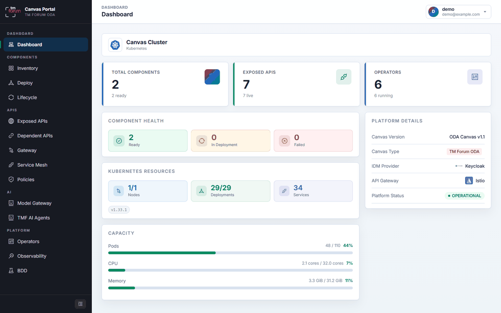
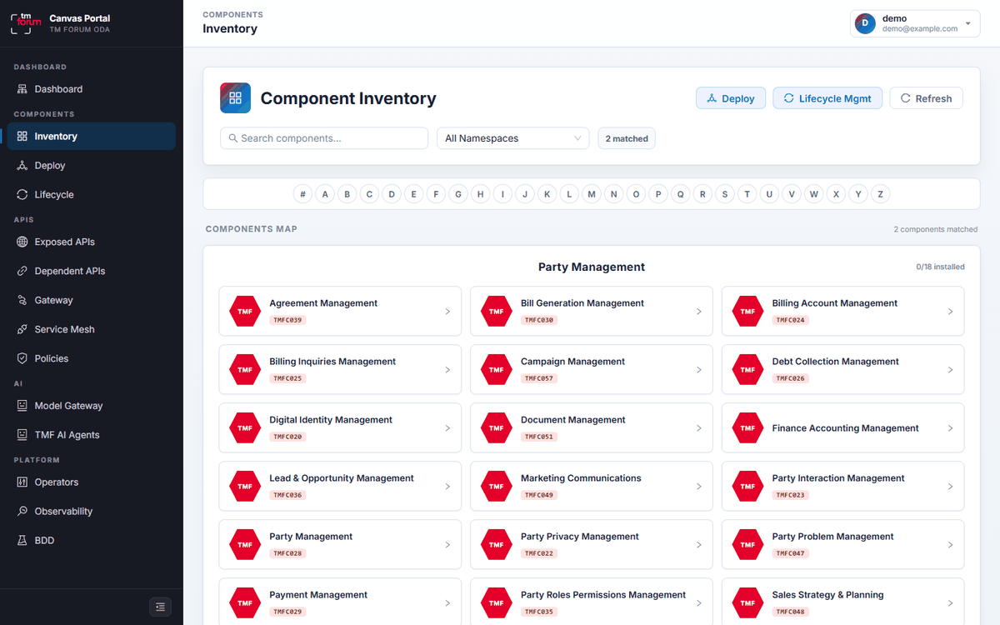
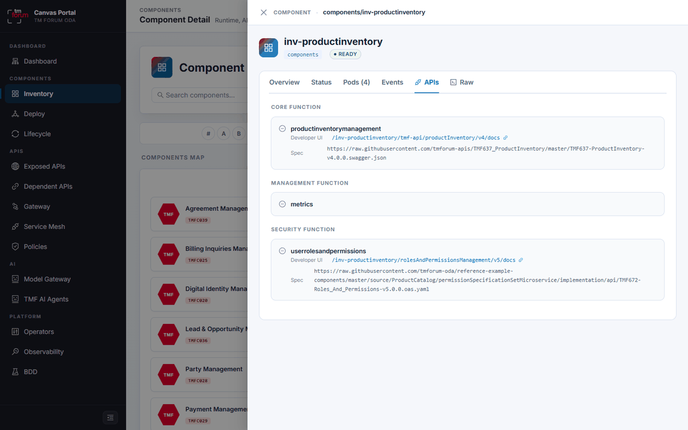
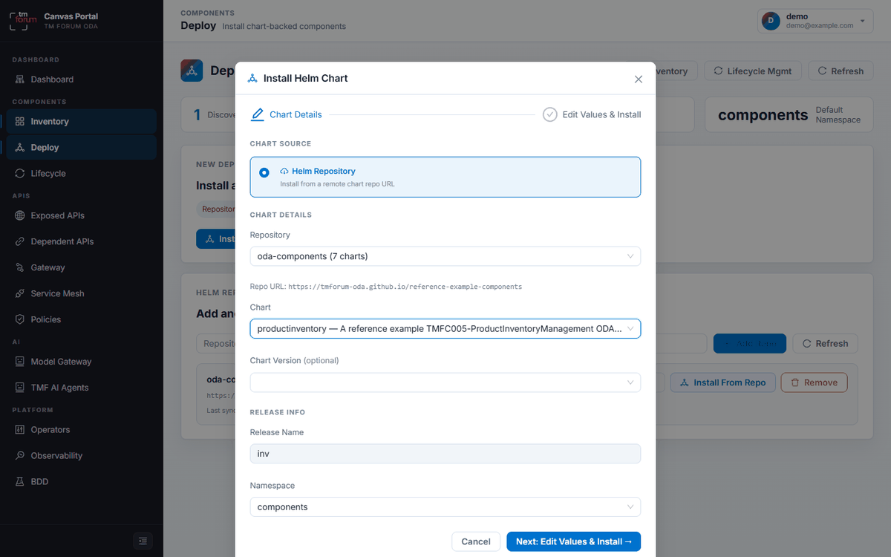
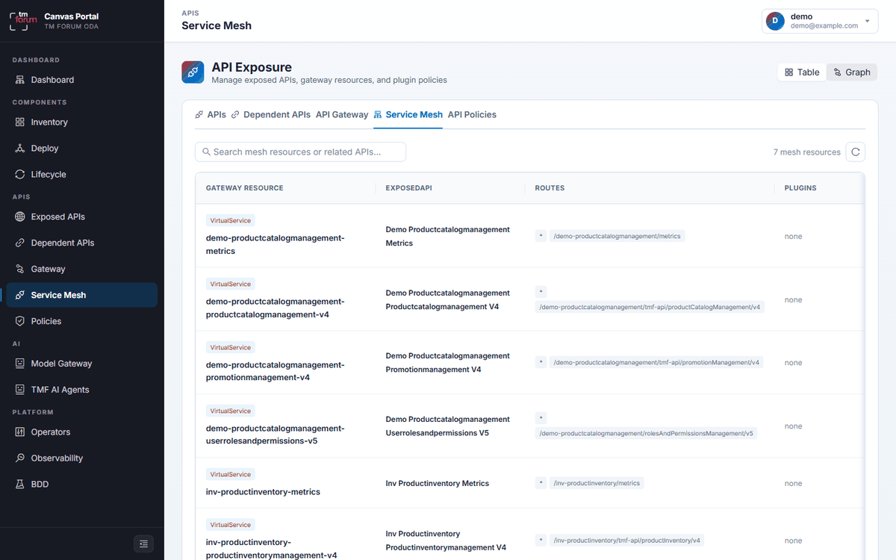
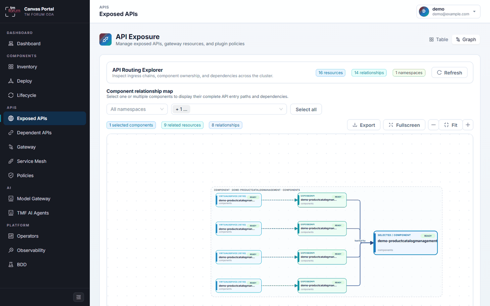
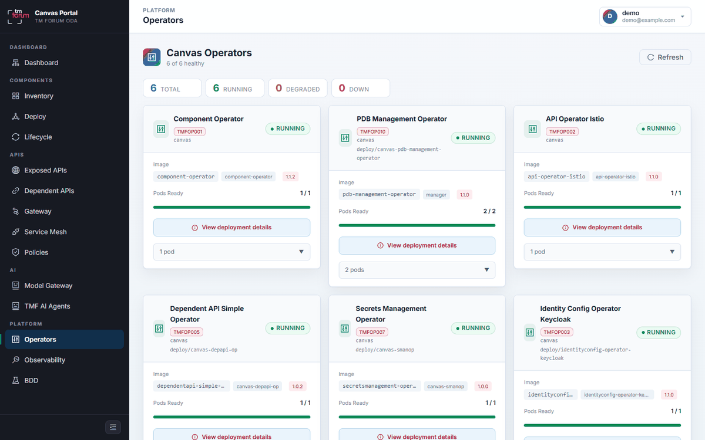
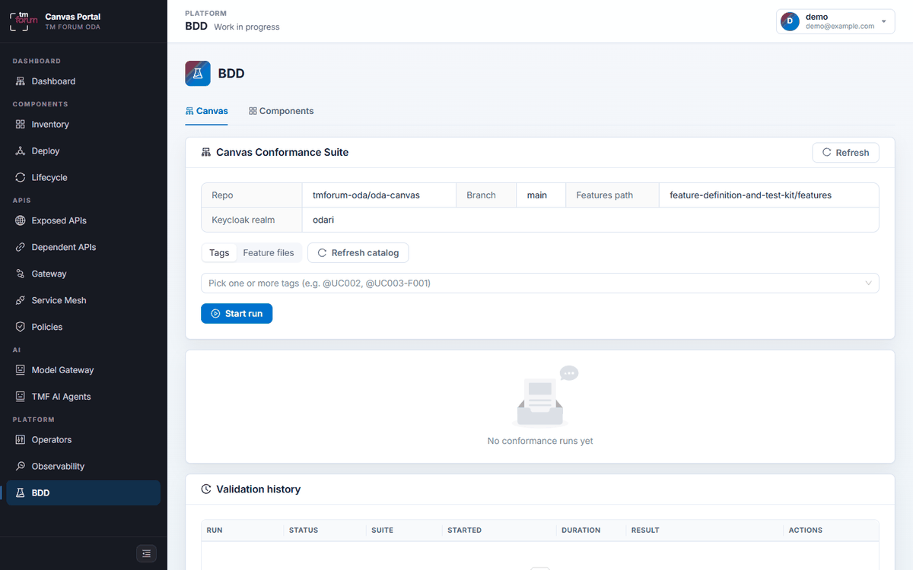

# A tour of the Canvas Portal v2

The Canvas Portal v2 is a web UI for an ODA Canvas. It shows what is running in the Canvas, from components and their APIs to the gateway routes and the Canvas operators, and it lets administrators install components and run the Canvas conformance tests.

This page walks through each part of the Portal, in the order of its menu. To install the Portal, see the [Canvas Portal v2 README](README.md). For a complete Canvas with the Portal on your own machine, run the script in [Run a local demo Canvas](../installation/local-demo-canvas.md).

The screenshots were taken on 20 November 2026, on a local demo Canvas (`canvas-oda` 1.2.6-rc9, Istio) with two reference components installed: Product Catalog and Product Inventory. The Portal was built from `main`.

## Logging in

The Portal logs users in through the Canvas's Keycloak, in the `odari` realm. Every logged-in user can view the Canvas. Only administrators can install, upgrade or uninstall components, manage Helm repositories, and run conformance tests: they need the `canvas-admin` realm role in Keycloak, usually through the `canvas-admin` group. See [Admin access](README.md#admin-access).

## Dashboard

The dashboard summarises the Canvas:

- **Total components, exposed APIs and operators,** with how many are ready, live or running;
- **Component health:** how many components are ready, still deploying or failed;
- **Kubernetes resources and capacity:** nodes, deployments, services, and pod, CPU and memory use;
- **Platform details:** the identity provider and API gateway that the Portal detected (here Keycloak and Istio), and whether the platform is operational.

## Components

### Inventory

The inventory is a map of the TM Forum component specifications, grouped by functional area, such as Party Management. Each area shows how many of its components are installed. Search, filter by namespace, or jump to a letter.

Select an installed component to open its details: an overview, its status, pods and events, the raw resource, and its APIs, grouped by core, management and security function, with links to each API's developer UI and specification.

### Deploy

The Deploy page installs components from Helm chart repositories. It is for administrators only.

1. Under **Helm repositories**, add a repository by name and URL. For the reference components, use `https://tmforum-oda.github.io/reference-example-components`. The Portal syncs the repository and lists its charts.
2. Select **Install Component** (or **Install From Repo** on the repository).
3. Choose the repository and chart, and optionally a chart version. Give the release a name and choose the namespace.
4. On the next step, edit the chart's values if you need to (**Load Default Values** fills in the chart's own), set a timeout, and select **Install Release**.

The component then appears in the inventory and moves through its deployment statuses to `Complete`, as it does when you install it with `helm install`. The Portal can only install into the namespaces its chart grants it, through `rbac.canvasInstallAccess.targetNamespaces`.

### Lifecycle

The Lifecycle page upgrades or uninstalls a release, and shows its Helm history. It is for administrators only, and works in the same namespaces as Deploy.

## APIs

The five pages in this section are tabs of one **API Exposure** view. Each has a **Table** and a **Graph** display.

| Tab | Shows |
|---|---|
| **Exposed APIs** | Every `ExposedAPI` in the Canvas, with its status (`LIVE` once it has a URL and a ready implementation), version, and the authentication, rate limit and gateway plugins applied to it. |
| **Dependent APIs** | Every `DependentAPI`: the APIs that components call, with the component, segment, status and the URL the Canvas resolved for each. |
| **Gateway** | The API gateway's routes, for a Canvas that uses Kong or Apache APISIX: `HTTPRoute` or `ApisixRoute` resources. Empty for an Istio Canvas. |
| **Service Mesh** | The service mesh's routes, for an Istio Canvas: one `VirtualService` per exposed API, with its path. |
| **Policies** | The policies the gateway enforces, such as rate limiting, authentication and CORS, from Kong `KongPlugin` or APISIX `ApisixPluginConfig` resources. Empty for an Istio Canvas, because the Istio API operator applies no policies. |

The **Graph** display is the API Routing Explorer. Choose one or more components to see how each request reaches them: from the gateway or mesh route, through the `ExposedAPI`, to the component, with its dependent APIs.

For what the gateway policies are and which API operator applies them, see [API exposure and gateway policies](../source/operators/TMFOP002-API-Management/API-exposure-and-gateway-policies.md).

## AI

- **Model Gateway** lists `ModelGatewayService` resources, which give components access to AI models through a model gateway (see the [Model-as-a-Service operator](../source/operators/TMFOP009-Model-as-a-Service/README.md)). You can declare a new service here. If the `ModelGatewayService` CRD isn't installed, the page says so.
- **TMF AI Agents** is work in progress. It lists the AI agents planned to help operate the Canvas.

## Platform

### Operators

The Operators page shows each Canvas operator with its TMFOP number, image and version, and whether its pods are ready. Select **View deployment details** for its replica counts and restarts, its pods, and each pod's live logs, which you can download.

The Portal finds operators by their `oda.tmforum.org/operator` labels, which the operator charts in `canvas-oda` 1.2.6-rc9 and later set.

### Observability

The Observability page links to Grafana, Prometheus and Langfuse, if it finds them. It looks for their services by name in the `default`, `monitoring`, `observability`, `prometheus`, `grafana` and `canvas` namespaces. To add an observability stack to the Canvas, see the [Observability tutorial](https://tmforum-oda.github.io/oda-ca-docs/docs/Observability-Tutorial/README.html).

### BDD

The BDD page runs the Canvas's conformance tests: the BDD features in [`feature-definition-and-test-kit`](../feature-definition-and-test-kit/README.md), fetched from the `oda-canvas` repository. It is for administrators only. Pick tags, such as `@UC002` for the component management use case, or feature files, and select **Start run**. The page keeps a history of runs, with their logs and Cucumber and HTML reports.

Conformance tests for components are planned (the **Components** tab).

## Known limitations

These were seen while taking the screenshots for this page. They are tracked in [issue 687](https://github.com/tmforum-oda/oda-canvas/issues/687).

- The dashboard always shows "ODA Canvas v1.1" as the Canvas version: the value is fixed in the frontend.
- On a Canvas without the Kubernetes Gateway API CRDs, the Gateway, Service Mesh and Policies tabs fail with "Failed to load". The [local demo script](../installation/local-demo-canvas.md) installs the CRDs.
- With the [observability stack](../charts/observability-stack/README.md) installed as release `observability`, its Grafana service is named `observability-grafana`, which the Observability page doesn't look for.
