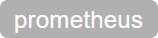

# Component-Registry Documentation

## Prerequisites

ODA Canvas is installed with default values.  
compreg not yet released?  
So, install from main branch neccessary.


## Port-Forward Component-Registry UI

```
kubectl port-forward -n canvas svc/canvas-compreg 8080:80
```

Open UI in Browser:

http://localhost:8080

<kbd></kbd>


## Deploy ODA Component r-cat

```
helm upgrade --install r-cat -n components --create-namespace feature-definition-and-test-kit/testData/productcatalog-v1
```

After a few seconds the UI shows the new ODA Component r-cat:

<kbd></kbd>

### Exposed API Information

In the column "Exposed APIs" there additional info for each endpoint is shown.

The name of the Exposed API is a link which can be clicked and shows the raw TMF-639 data for this endpoint.

<table>

<tr><td></td>
<td>The exposed API is of format Open-Api. Clicking on the icon will open the link in a new tab.</td></tr>

<tr><td></td>
<td>The exposed API is of format Prometheus for scraping metrics.</td></tr>

<tr><td></td>
<td></td></tr>

<tr><td></td>
<td>URL to the API endpoint. Klicking the icon opens the URL in a new tab.</td></tr>

<tr><td></td>
<td>URL to the Swagger UI.Klicking the icon opens the Swagger UI in a new tab.</td></tr>

<tr><td></td>
<td>Shows thet the Exposed API is available. If unavailable a red icon is shown.</td></tr>

</table>


