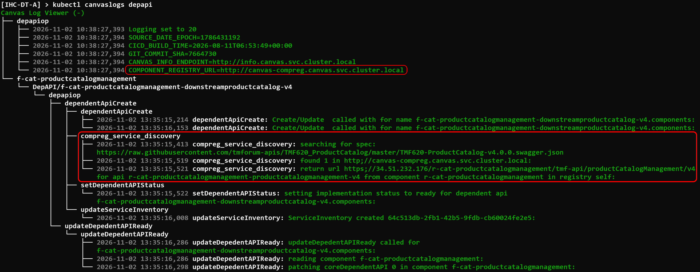
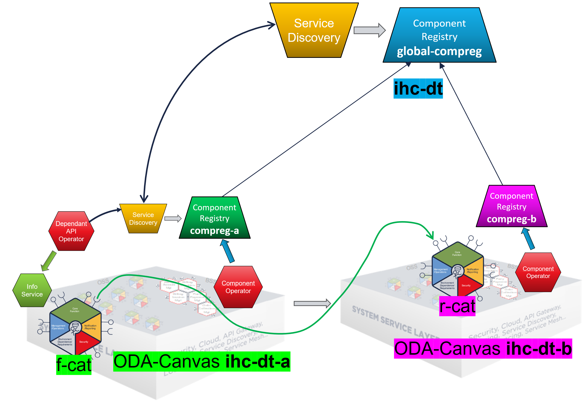

# Component-Registry

The Component-Registry maintains a state of the deployed ODA Components and Exposed APIs of an ODA Canvas.
Its purpose is to serve as an inventory which allows resolving API dependencies between ODA Components.

It is also prepared to support Multi-Canvas scenarios, where an upstream Component-Registry allows resolving dependencies between different ODA Canvas installations.
 


## Prerequisites

ODA Canvas is installed with default values.  
(compreg not yet released. So, install from main branch is neccessary)


## Port-Forward Component-Registry UI

to access the UI of the Component-Registry a port-forwarding (or any other kind of ingress) has to be established to make the UI accessible:

```
kubectl port-forward -n canvas svc/canvas-compreg 8080:80
```

Now the UI can be opened in a Browser:

http://localhost:8080

<kbd></kbd>


## Deploy ODA Component r-cat

From the BDD tests we can deploy the Retail-Catalog "r-cat": 

```
helm upgrade --install r-cat -n components --create-namespace feature-definition-and-test-kit/testData/productcatalog-v1
```

After a few seconds the UI shows the new ODA Component r-cat together with its exposed APIs:

<kbd></kbd>


### Exposed API Information

In the column "Exposed APIs" additional info for each endpoint is shown.

The name of the Exposed API is a link which can be clicked and shows the raw TMF-639 data for this endpoint in the same way as clicking on "View Details" in the endpoint list below.

<table>

<tr><td></td>
<td>The exposed API is of format Open-Api. Clicking on the icon will open the link in a new tab.</td></tr>

<tr><td></td>
<td>The exposed API is of format Prometheus for scraping metrics.</td></tr>

<tr><td></td>
<td></td></tr>

<tr><td></td>
<td>URL to the API endpoint. Klicking the icon opens the URL in a new tab.</td></tr>

<tr><td></td>
<td>URL to the Swagger UI. Klicking the icon opens the Swagger UI in a new tab.</td></tr>

<tr><td></td>
<td>Shows thet the Exposed API is available. If unavailable a red icon is shown.</td></tr>

</table>

As we can see, r-cat is exposing the Open-API `https://raw.githubusercontent.com/tmforum-apis/TMF620_ProductCatalog/master/TMF620-ProductCatalog-v4.0.0.swagger.json`.


## Resolve a Dependent-API

Next we want to see how dependency resolution works in the ODA Canvas.

Therefore we deploy another ODA Component "f-cat" which has a dependency to the exposed API of "r-cat":

```
helm upgrade --install f-cat -n components --create-namespace feature-definition-and-test-kit/testData/productcatalog-dependendent-API-v1
```

To see the dependency resolution we look into the logfile of the Depent-API Operator logs:

```
kubectl logs -n canvas deployment/canvas-depapi-op
```

As this is hard to read we can also use the pretty printed output of the [kubectl canvaslogs plugin](/source/utilities/canvas-log-viewer/python_alternative/README.md): 

```
kubectl canvaslogs depapi
```

<kbd></kbd>


In the red marked block we can see that the Dependant-API Operator contacted the cluster local Component-Registry 
and got one matching endpoint r-cat-productcatalogmanagement.

We can see the details in the DependentAPI custom resource:
 

```
$ kubectl get DependentAPI -n components   # or shorter: kubectl get depapi -n components

NAME                                                         READY   AGE   SVCINVID
URL
f-cat-productcatalogmanagement-downstreamproductcatalog-v4   true    38m   64c513db-2fb1-42b5-9fdb-cb60024fe2e5
https://11.22.33.44/r-cat-productcatalogmanagement/tmf-api/productCatalogManagement/v4
```

# Multi-Canvas Support

## Warning

The following description uses an unsecured installation of the central Component-Registry.
This is to simplify the Use-Case and make it easy to understand.
A description how a secure setup of Component-Registry can be done can be found in 
[Secured Setup of Component-Registry](SECURED-SETUP-COMPREG.md)


## Overview

The Component-Registry supports replication to an upstream Component-Registry.
This allows a setup where multiple ODA Canvas instances replicate there exposed APIs
into a central Component-Registry. For our scenario it looks like this:

<kbd></kbd>


## Install a Central (Standalone) Component-Registry

The Helm charts used for installing the cluster-local Component-Registry can also be used to 
install the standalon Component-Registry:

```
helm upgrade --install -n compreg global-compreg --create-namespace charts/component-registry --set=canvasResourceInventory=  
```

The only difference is to unset the canvasResourceInventory value.
If this canvasResourceInventory is set, then a background process is started, 
which listens to changes in the local cluster and replicates the data from the 
ResourceInventory to the Compoennt-Registry.


