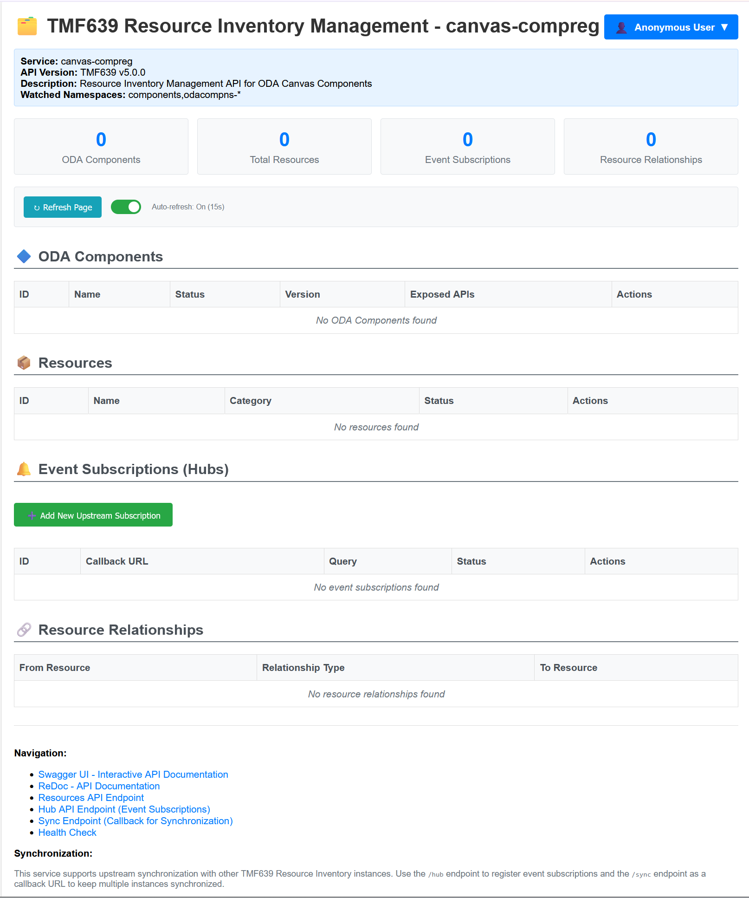
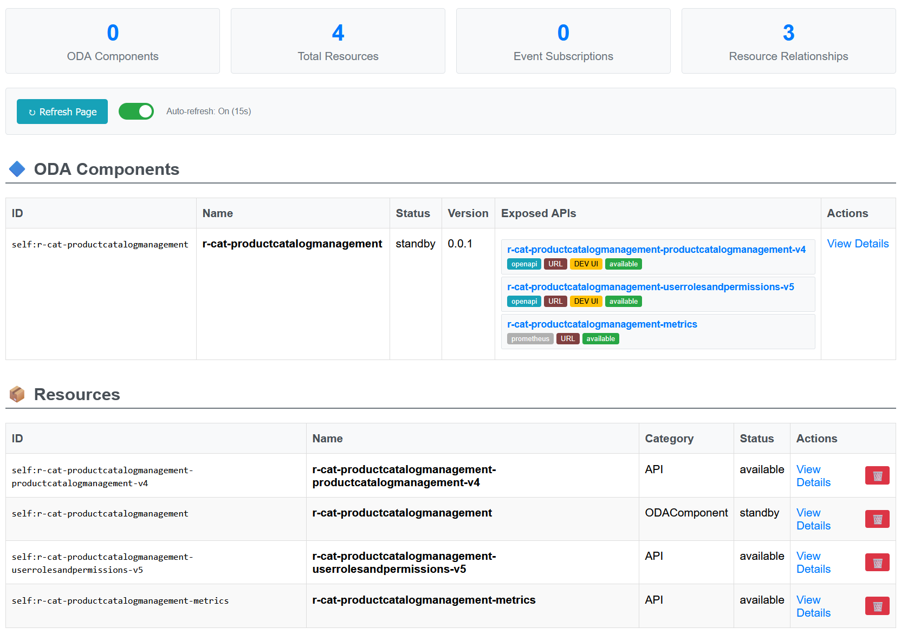

# Component-Registry Documentation

## Prerequisites

ODA Canvas is installed with default values.  
compreg not yet released?  
So, install from main branch neccessary.


## Port-Forward Component-Registry UI

```
kubectl port-forward -n canvas svc/canvas-compreg 8080:80
```

Open UI in Browser:

http://localhost:8080

<kbd></kbd>


## Deploy ODA Component r-cat

```
helm upgrade --install r-cat -n components --create-namespace feature-definition-and-test-kit/testData/productcatalog-v1
```

After a few seconds the UI shows the new ODA Component r-cat:

<kbd></kbd>


