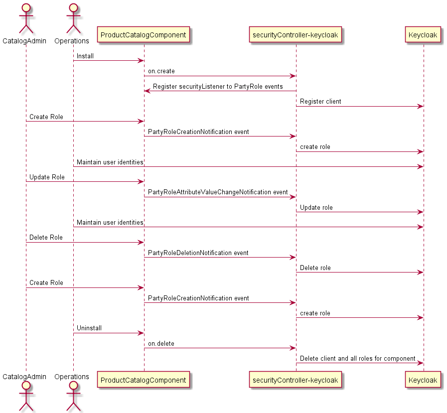
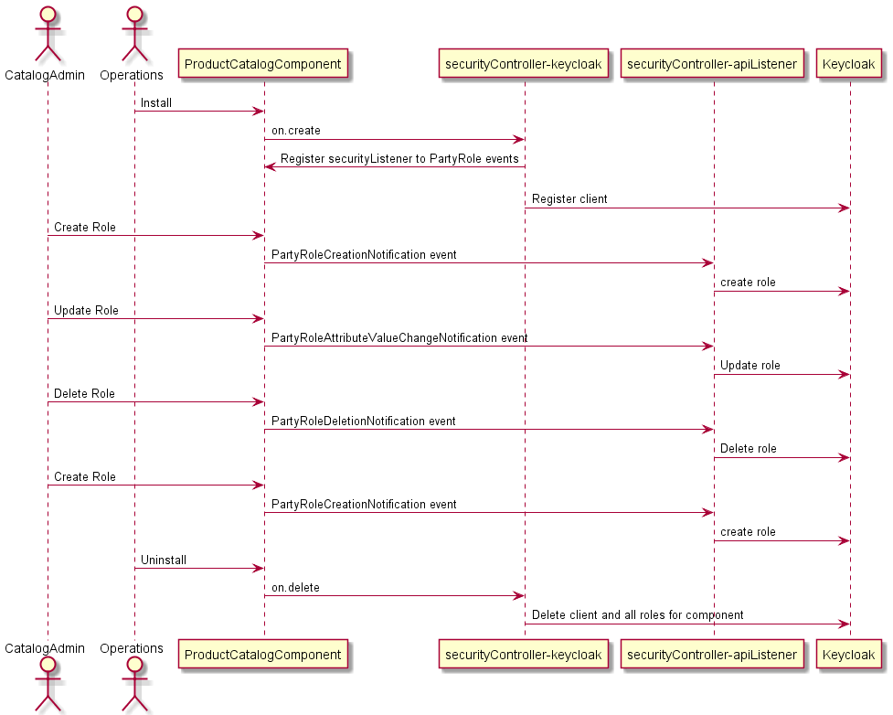

# Identity Config operator for Keycloak - Introduction 

This is the reference implementation of an identity config operator that takes metadata from an ODA Component and uses it to automatically configure the Identity service (using Keycloak in the reference implementation). A component can define its roles statically in the component specification, or dynamically by exposing an API that lists the roles to be added to the identity service:

* the **TMF672 User Roles and Permissions** API (`permissionSpecificationSetAPI` in the `IdentityConfig`), where each `PermissionSpecificationSet` becomes a role. This is the recommended option; or
* the **TMF669 Party Role Management** API (`partyRoleAPI`), where each `PartyRole` becomes a role. This is still supported, but will be deprecated.

See [README-PermissionSpecificationSet.md](../README-PermissionSpecificationSet.md) for the TMF672 support, and the [IdentityConfig data model](../README.md) for examples. The sequence diagrams below show the TMF669 PartyRole flow; the TMF672 flow is the same, with `PermissionSpecificationSet` events in place of `PartyRole` events. The sequence diagram shows the overall flow:





The identity config operator consists of two modules, both written in Python. The first module uses the KOPF (https://kopf.readthedocs.io/) framework to listen for components being deployed in the ODA Canvas. It sets up the base `Client` registration in Keycloak and then registers for call-back events from the component's TMF672 or TMF669 API. The second module (`identity-listener-keycloak`) provides the API server where these callback events are handled. It receives create and delete events and creates or deletes the corresponding roles in Keycloak (TMF672 update events are ignored). See the more detailed sequence diagram below:





**Notes**

Keycloak setup

Realm = whole organisation                                                                                                                                  
Client (within Realm) = 1 App or component

Roles can be scoped at realm or client level                                                                                                                
Users can be scoped at realm or client level


**Tasks to set up development environment (tested on Docker for Windows)**

Install keycloak and set Environmnet variables for username and password (from https://www.keycloak.org/getting-started/getting-started-kube)

```
kubectl create -f https://raw.githubusercontent.com/keycloak/keycloak-quickstarts/latest/kubernetes-examples/keycloak.yaml
```

Keycloak is created with a Service exposed at `http://localhost:8080/auth/`


To run python module standalone:

1. Ensure url's `kcBaseURL` and `prBaseURL` are set correctly in keycloaktestapp.py
2. Install required python modules with `pip install -r .\requirements.txt`
3. Run `python keycloaktestapp.py`
4. Set the environment variables for login to keycloak

```
$env:KEYCLOAK_USER = "admin"
$env:KEYCLOAK_PASSWORD = "adpass"
```

5. Configure a new realm `odari` in keycloak.
6. Configure a new client `r1-productcatalog` in the `odari` realm.

**Interactive development and Testing of operator using KOPF**

The production operator will execute inside a Kubernetes Pod. For development and testing, it is possible to run the operator on the command-line (or inside a debugger). Kopf includes a `--standalone` attribute to allow the operator to execute in a standalone mode. This means that the operator will run independently, without relying on any external controllers or frameworks. It is particularly useful for development and debugging purposes, as it allows you to run and test your operator locally on your machine.

Run locally in command-line: 
```
kopf run --namespace=components --standalone .\identityConfigOperatorKeycloak.py
```

This mode will use the kubeconfig file (typically located at `$HOME/.kube/config`) to as long as `kubectl` is correctly configured for your cluster, the operator should work. 

You need to ensure you turn-off the operator executing in Kubernetes (for example, by setting the replicas to 0 in the operator Deployment).

The command above will execute just the Keycloak identity operator. You will also need to execute the other operators relavant for your Canvas implementation - these can be executed in separate terminal command-lines.

**Note: The keycloak identity operator may have issues calling http services locally inside the cluster - for example it may try to call `http://idlistkey.canvas.svc.cluster.local` and fail as this can only be executed inside the Kubernetes cluster.**