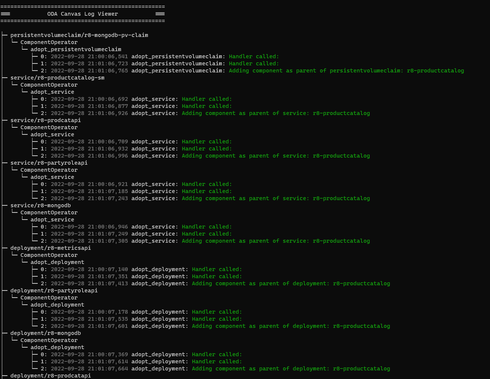

# Canvas Log Viewer utility

This is a simple kubectl utility to display log information on the ODA Canvas for a Component.

# Installation

Requires Node.js 20 or later.

```
npm install @lesterthomas/kubectl-canvas_logs -g
```


Then, to run plugin within kubectl:

```
kubectl canvas-logs [component name] 
```


The utility will use the current kubeconfig to connect to the Kubernetes cluster. You should get a screen like the one below:



To exit the utility, type `CTRL-C`


## Development

The log parsing and tree-building logic is in `lib/logTree.js` and the Kubernetes helpers are in `lib/kubernetes.js`. Unit tests use the built-in Node.js test runner:

```
npm install
npm test
```

## Publishing

To publish a new version, update the version number in the package.json file and use the command

```
npm publish --access public
```