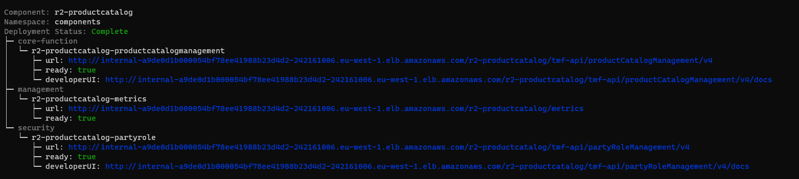

# Component Viewer utility

This is a simple kubectl utility to display information on the ODA Component deployment and lifecycle.

# Installation

Requires Node.js 20 or later.

```
npm install @lesterthomas/kubectl-component_info -g
```


Then, to run plugin within kubectl:

```
kubectl component-info
```


The utility will use the current kubeconfig to connect to the Kubernetes cluster. It will show 'No ODA Components to view' if there are no components being deployed. If there are components, you will get a screen like the one below:



To exit the utility, type `CTRL-C`


## Testing locally

During development, you can test the utility locally by installing the dependencies with

```
npm install
```

and running the utility against your current kubeconfig with

```
npm start
```

The component status formatting logic is in `lib/componentTree.js` and the Kubernetes helpers are in `lib/kubernetes.js`. Run the unit tests (no cluster needed) with

```
npm test
```

## Publishing

To publish a new version, update the version number in the package.json file and use the command

```
npm publish --access public
```